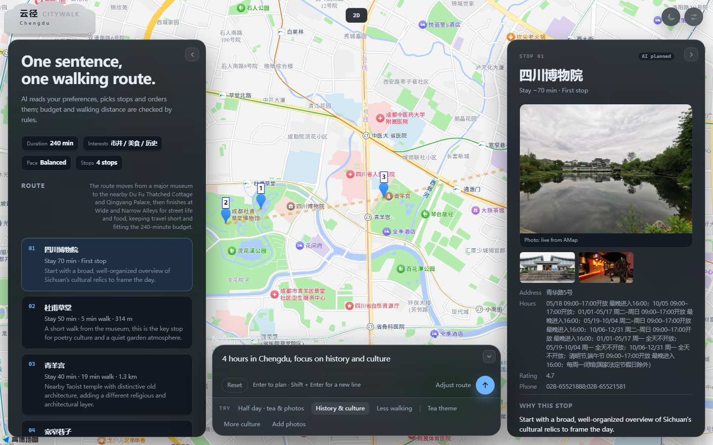
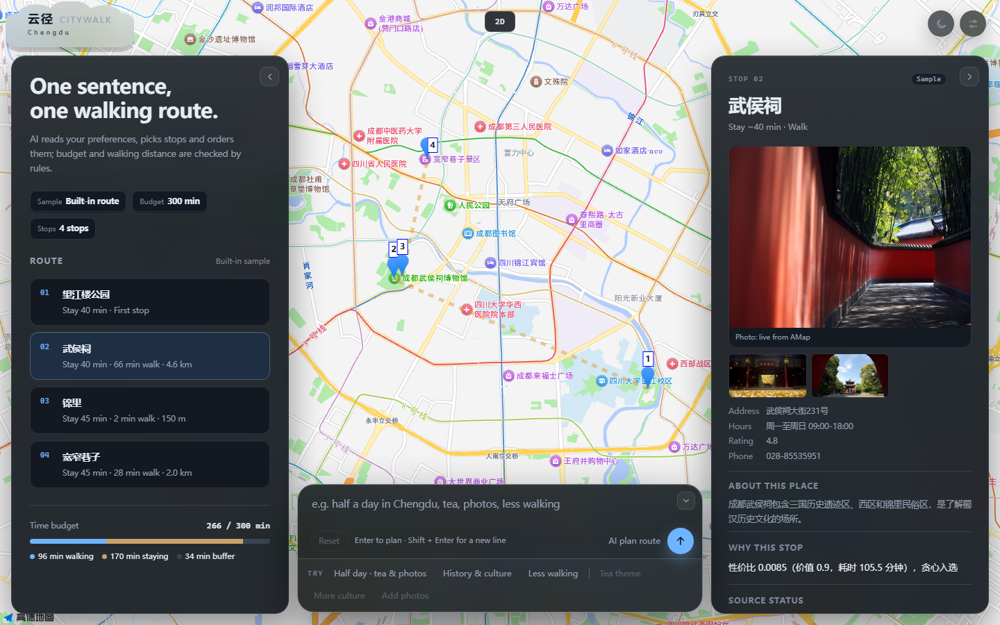
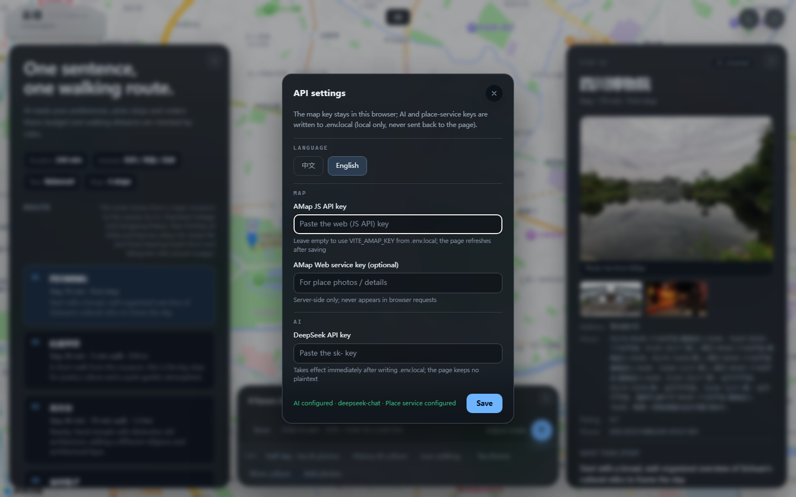
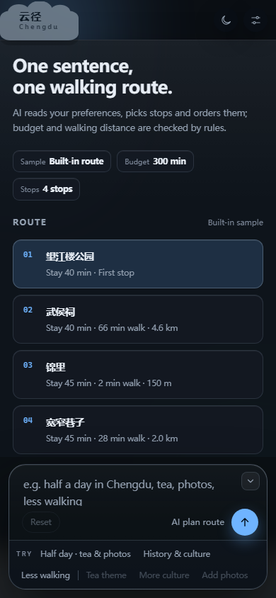

# CityWalk with Ease

### Yunjing CityWalk · Chengdu edition

**One sentence of preferences in. An executable Chengdu walking route out.**

[](https://github.com/leesirleesirlee-star/CityWalk_with_ease/actions/workflows/ci.yml)
[](LICENSE)
[](package.json)
[](tests/)

Yunjing CityWalk (云径) turns free-form travel wishes — *"half a day in Chengdu, tea, photos, less walking"* — into a
walkable route: ordered stops, stay time, walking legs, a reason for every stop, and a one-line introduction.
A DeepSeek model does the **choosing, ordering and writing**; a deterministic engine checks **budget, timing,
coordinates and the contract**, so the model can never hand you an itinerary that does not fit the clock.

This repository is the **standalone Chengdu edition**: only what is needed to run the Chengdu route planner —
the AI planning service, the POI/knowledge base, the AMap basemap and the local fallback pipeline.

<p align="center">
  
</p>

> Captured from a live local demo with real DeepSeek and AMap keys. Map tiles and place photos © AMap (高德地图).

---

## Table of contents

- [Highlights](#highlights)
- [How a route is generated](#how-a-route-is-generated)
- [Quick start](#quick-start)
- [Configuration](#configuration)
- [Screenshots](#screenshots)
- [API](#api)
- [Project structure](#project-structure)
- [Data and sources](#data-and-sources)
- [Testing](#testing)
- [Known limitations](#known-limitations)
- [Tech stack](#tech-stack)
- [Contributing](#contributing)
- [License](#license)

---

## Highlights

| Capability | What it does |
| --- | --- |
| **Natural language → route** | Understands duration, interests, pace, companions and constraints such as "less walking" |
| **AI stop selection + ordering** | DeepSeek picks 3–6 stops from 19 geocoded candidates and returns `stops[]` in route order |
| **Per-stop reason and intro** | The same model call returns `why` and a short `intro` grounded in the POI summary only |
| **Hard budget validation** | Stops are trimmed/compressed by deterministic rules before the itinerary is accepted |
| **Walking legs** | Real `AMap.Walking` routes when keys are configured; dashed straight-line estimates otherwise |
| **Place details** | `/api/agent/place` returns up to 4 real photos, address, opening hours, rating and phone number |
| **AMap basemap** | Optional: real streets, landmarks and markers that stay in sync with the timeline |
| **Local fallback** | No key, timeout or bad JSON → deterministic local pipeline, clearly labelled in the UI |
| **Contract-first output** | Every result is validated against the `tour_script` **1.1.0** JSON Schema before rendering |
| **Bilingual UI** | Chinese / English switch, light / dark themes, responsive down to a 390 px phone |

## How a route is generated

```text
Browser (index.html)
  │  POST /api/agent/plan  { text: "成都4小时，多看历史人文景点，5个景点以上" }
  ▼
Vite / preview middleware (server/agent/*)
  │  1. deterministic intent parser → budget, start time, pace, constraints, min stops
  │  2. send 19 geocoded candidates to DeepSeek /chat/completions
  │  3. validate the plan: known ids, no duplicates, stay 15–120 min, ≥ 2 stops
  │  4. keep the AI order, compute arrival times and walking legs
  │  5. compress stays / truncate from the tail to respect the budget
  │  6. compose and validate a tour_script 1.1.0 → return it
  ▼
DeepSeek API          AMap Web Service (place photos)
```

The important part: **the final `route[]` order comes from the model.** The rules only validate, compress and
possibly truncate — they never silently reorder the AI's choice into a different route.

If the AI call fails (`TIMEOUT`, `INVALID_JSON`, `NO_CANDIDATES`, `NOT_CONFIGURED`), the browser falls back to
`src/agent/citywalk/masterPipeline.js`, and the UI labels the result **"local fallback"** / **本地兜底**.

## Quick start

Requirements: **Node.js ≥ 20** (tested on 22) and npm ≥ 10.

```bash
git clone https://github.com/leesirleesirlee-star/CityWalk_with_ease.git
cd CityWalk_with_ease

npm install

# Optional: enable AI planning and AMap basemap
copy .env.example .env.local      # Windows
cp .env.example .env.local        # macOS / Linux
# then edit .env.local

npm run dev
# open http://127.0.0.1:5178/
```

No keys? The app still runs: the page loads, routes are still generated by the deterministic planner,
the map shows the schematic SVG fallback, and the detail panel is text-only. The status chip reads
`AI not configured (local fallback)`.

### CLI recipes

```bash
npm run build     # production build in dist/
npm run preview   # serve the build at http://127.0.0.1:5179/
npm test          # 122 node:test checks, no extra dependencies
```

> The `/api/agent/*` endpoints are provided by the Vite dev/preview middleware. A plain static `dist/`
> deployment does not include them — run `npm run dev` / `npm run preview`, or deploy an equivalent service.

## Configuration

Copy `.env.example` to `.env.local` (git-ignored) and fill in what you need. Every key is optional.

| Variable | Purpose | Required |
| --- | --- | --- |
| `DEEPSEEK_API_KEY` | AI stop selection, ordering, reasons and intros | For AI planning; otherwise local fallback |
| `DEEPSEEK_BASE_URL` | API base URL, default `https://api.deepseek.com` | No |
| `DEEPSEEK_MODEL` | Model name, default `deepseek-chat` | No |
| `AMAP_WEB_KEY` | Server-side place photos / address / hours / rating (**Web service** key) | No |
| `VITE_AMAP_KEY` | Browser basemap and markers (**Web / JS API** key) | No |
| `AMAP_SECURITY_CODE` | JS API security code, forwarded by the local `/_AMapService` proxy | Only for real walking routes |
| `VITE_AMAP_3D` | Enable the AMap 3D view (`true` / `false`) | No |

AMap console notes:

- `VITE_AMAP_KEY` must be a **Web (JS API)** key with `http://127.0.0.1:5178` in the Referer allow-list.
- `AMAP_WEB_KEY` is a separate **Web service** key used only by the server; do not mix the two.
- `AMAP_SECURITY_CODE` is server-side only — do **not** add the `VITE_` prefix.
- With only the JS key, the basemap works but `AMap.Walking` may fall back to dashed straight lines.

Keys can also be entered in the in-app **API settings** dialog: the map key stays in `localStorage`,
while AI / place keys are written to `.env.local` by a loopback-only endpoint and never echoed back.
Never commit `.env.local`.

## Screenshots

| AI-planned route + place details | Built-in sample route |
| --- | --- |
|  |  |

| API settings (bilingual UI) | Mobile layout (390 × 844) |
| --- | --- |
|  |  |

## API

All endpoints are served by the local middleware in `server/agent/` during `npm run dev` / `npm run preview`.

### `GET /api/agent/health`

```json
{
  "ok": true,
  "configured": true,
  "amap_configured": true,
  "model": "deepseek-chat",
  "catalog_size": 19,
  "coords_size": 19
}
```

### `POST /api/agent/plan`

```json
{ "text": "成都4小时，多看历史人文景点，5个景点以上", "city": "chengdu" }
```

Success (`200`):

```json
{
  "ok": true,
  "source": "llm",
  "model": "deepseek-flash",
  "elapsed_ms": 1800,
  "intent": { "budget_min": 240, "interests": ["历史"], "constraints": [], "pace": "balanced", "min_stops": 5 },
  "stops": [{ "poi_id": "cd-106", "why": "…", "intro": "…", "stay_min": 25 }],
  "route_reason": "…",
  "cut_stops": [],
  "script": { "schema_version": "1.1.0", "meta": {}, "route": [] },
  "warnings": []
}
```

Failure returns HTTP `200` with `{ "ok": false, "code": "TIMEOUT | INVALID_JSON | NO_CANDIDATES | NOT_CONFIGURED", "message": "…" }`
so the browser can silently fall back to the local pipeline.

### `GET /api/agent/place?id=cd-101`

```json
{
  "ok": true,
  "name": "成都杜甫草堂博物馆",
  "address": "青华路37号",
  "opening_hours": "周一至周日 09:00-18:00",
  "rating": 4.8,
  "tel": "028-68921800",
  "photos": [{ "url": "https://…", "source": "amap" }],
  "intro": "…",
  "source": "amap"
}
```

### `POST /api/agent/config`

Writes API keys to `.env.local`. Only accepts requests from loopback addresses and never returns the key values.
The in-app settings dialog uses this endpoint.

See [docs/API.md](docs/API.md) for full request/response details and error codes.

## Project structure

```text
CityWalk_with_ease/
├─ index.html                  # single-page workbench (timeline · map · detail)
├─ vite.config.js              # Vite, /_AMapService proxy, /api/agent middleware
├─ .env.example                # documented environment variables
├─ src/
│  ├─ app/chrome.js            # theme control
│  ├─ ui/                      # map, timeline, detail view, settings, i18n
│  ├─ agent/
│  │  ├─ routeSequence.js      # arrival times + walking legs, keeps AI order
│  │  └─ citywalk/             # deterministic planner, budget, resilience, master pipeline
│  └─ baidu/coord.js           # WGS84 ↔ GCJ-02
├─ server/agent/               # /api/agent/plan, /place, /config, /health
├─ data/cities/chengdu/        # 24 POIs (GeoJSON), route catalog, sample scripts
├─ knowledge/                  # tour_script schema, attraction + route-POI knowledge
├─ tools/schema-check.mjs      # dependency-free JSON Schema subset validator
├─ tests/                      # node:test suites (122 checks)
└─ docs/                       # API, architecture, data sources, screenshots
```

## Data and sources

- **24 Chengdu POI features, 19 with WGS84 coordinates.** Five legacy attractions remain `unmatched` on
  purpose — coordinates are never invented.
- **Coordinates:** OpenStreetMap / Overpass (original 10 POIs), Wikipedia / Wikidata / OSM Nominatim for the
  14 route POIs (`cd-101`–`cd-114`).
- **Knowledge status:** every newly added POI carries `verification_status: "pending"`; the app never claims
  official verification.
- **POI photos** come from the AMap Web service at request time (user-generated content) and are attributed in
  the UI. They are not redistributed with this repository.
- **Narration** is editorial content, not an official guide. Opening hours, tickets and booking rules must be
  checked against official announcements. Coordinates are approximate public geographic data, not for navigation.

Full attribution and license notes: [docs/DATA_SOURCES.md](docs/DATA_SOURCES.md).

## Testing

```bash
npm test
```

**122 checks, 0 failures** using the built-in `node:test` runner and a zero-dependency JSON Schema validator.
They cover intent parsing, budget maths, route ordering, guardrails, resilience/fallback, schema 1.1.0
conformance, rendering helpers and the master pipeline. No network or API key is required.

```bash
npm run build   # verifies the whole front-end bundles (Vite 5)
```

## Known limitations

1. **4 hours / 5–6 stops is genuinely tight.** The planner compresses each stay to 25–35 minutes to keep the
   requested stop count. For 45+ minutes per stop, raise the budget or ask for fewer stops.
2. **The AI selects, orders and writes — it does not research the live web.** Intros are grounded in the local
   POI summaries and labelled "not individually verified"; photos are fetched live from AMap.
3. **AMap photos are user-generated content.** Quality and freshness are not guaranteed; the source is shown.
4. **Some photo URLs are `http://`.** Fine for a localhost demo; an HTTPS deployment needs an image proxy to
   avoid mixed content.
5. **A static `dist/` has no `/api/agent/*`.** Use `npm run dev` / `npm run preview` or deploy an equivalent service.
6. **New POIs are `pending`.** Opening hours and ticket rules must be confirmed on site or from official sources.
7. **Chengdu only.** The 3D scenes, Helsinki/Paris/Lyon experiments and legacy pages of the original research
   repository are intentionally not included in this edition.

## Tech stack

| Layer | Choice |
| --- | --- |
| Build | Vite 5 (`base: './'`, deployable under any sub-path) |
| Front end | Native ES modules + CSS, no framework |
| Map | AMap JS API 2.0 (optional); schematic SVG fallback |
| AI | DeepSeek `chat/completions` via a server-side middleware |
| Validation | `knowledge/tour_script.schema.json` (JSON Schema 2020-12 subset) |
| Tests | `node:test` + `tools/schema-check.mjs` |
| Data | Local JSON / GeoJSON knowledge base, no database |

## Documentation

| Document | Contents |
| --- | --- |
| [docs/ARCHITECTURE.md](docs/ARCHITECTURE.md) | Layers, request lifecycle, fallback strategy, data contract |
| [docs/API.md](docs/API.md) | Endpoints, request/response examples, error codes, security notes |
| [docs/DATA_SOURCES.md](docs/DATA_SOURCES.md) | POI dataset, coordinate sources, licenses and attribution |
| [CONTRIBUTING.md](CONTRIBUTING.md) | Development setup, conventions, pull-request process |
| [SECURITY.md](SECURITY.md) | Vulnerability reporting and key-handling model |
| [CHANGELOG.md](CHANGELOG.md) | Release history |

## Contributing

Contributions are welcome. Please read [CONTRIBUTING.md](CONTRIBUTING.md) and the
[Code of Conduct](CODE_OF_CONDUCT.md). Run `npm test` and `npm run build` before opening a pull request,
and never commit API keys.

## License

[MIT](LICENSE) for the source code. Data, map tiles and place photos keep their own licenses — see
[docs/DATA_SOURCES.md](docs/DATA_SOURCES.md). Chinese POI names, summaries and narration are kept in their
original language as the source of truth; the interface itself is bilingual.
